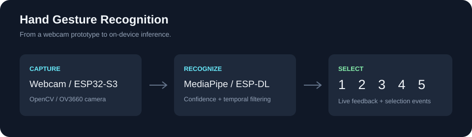
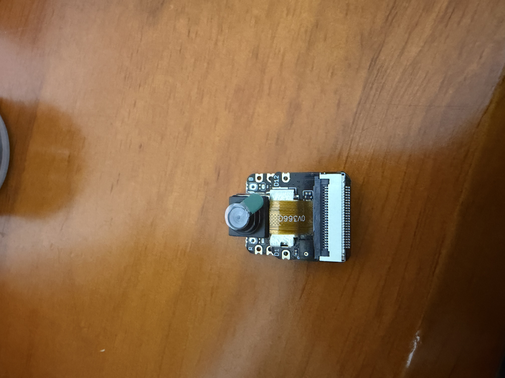

# Hand Gesture Recognition

Recognize hand gestures **1–5** on a webcam or directly on an **ESP32-S3**.

**Python · OpenCV · MediaPipe · C++ · ESP-IDF · ESP-DL**



<details>
<summary>Hardware photo — XIAO ESP32S3 Sense + OV3660</summary>
<p align="center">
  
</p>
</details>

| PC prototype | Embedded version |
| --- | --- |
| Webcam → MediaPipe landmarks → finger counting | OV3660 camera → ESP-DL hand detection → gesture classification |
| Live OpenCV window | Local Wi-Fi camera preview in a browser |
| Python | C++ / ESP-IDF |

Both versions filter unstable readings and emit a selection once a gesture is held.
The ESP32 version uses pretrained quantized models; no training is required.

## Webcam

Use Python 3.10–3.13 with direct access to your webcam.

```bash
cd hand-gesture
python -m venv .venv
```

Activate the environment, then install and run:

```bash
# Linux / macOS: source .venv/bin/activate
# Windows PowerShell: .\.venv\Scripts\Activate.ps1
python -m pip install -r requirements.txt
python app.py
```

The model downloads on the first run. Show one hand to the camera; press **Q** to quit.
On WSL without a camera device, run the application with Windows Python.
See the [PC instructions](hand-gesture/README.md).

## ESP32-S3

Hardware: **XIAO ESP32S3 Sense with camera**, 8 MB PSRAM, 8 MB flash and a USB data cable.
An ESP32-S3-EYE camera profile is also available.
Install **ESP-IDF 5.4.2** and open its activated terminal.

```bash
cd hand-gesture-esp32
idf.py -B build-local set-target esp32s3
idf.py -B build-local menuconfig
```

Select **Hand gesture application → Camera board → Seeed XIAO ESP32S3 Sense**.
For the XIAO, start with **Flip camera vertically** unchecked. Save and exit.

```bash
# Windows: replace COM5 with your board's port.
# Linux: replace COM5 with /dev/ttyACM0 or the detected device.
idf.py -B build-local -p COM5 build flash monitor
```

Connect your phone or computer to **HandGesture-ESP32**, password **gesture123**,
then open **http://192.168.4.1**. Stay connected even if the network has no Internet.
The page shows the camera image, predicted class, confidence and accepted digit.

For Windows ESP-IDF, keep the checkout on a local drive such as
`C:\esp-projects\hand-gesture-recognition`, rather than a `\\wsl.localhost\...` path.
The first build downloads the required libraries and models automatically.

See the [firmware instructions](hand-gesture-esp32/README.md) for configuration,
memory constraints and tests. Model accuracy depends on lighting, hand pose and visibility.

## Tests

```bash
python -m unittest discover -s hand-gesture -v
cmake -S hand-gesture-esp32/host -B hand-gesture-esp32/build-host
cmake --build hand-gesture-esp32/build-host
ctest --test-dir hand-gesture-esp32/build-host --output-on-failure
```

The host tests check the shared C++ decision logic; camera inference runs on the board.
Builds, virtual environments, downloaded models, libraries and runtime logs are excluded from Git.
`dependencies.lock` is kept to reproduce the firmware dependencies.
